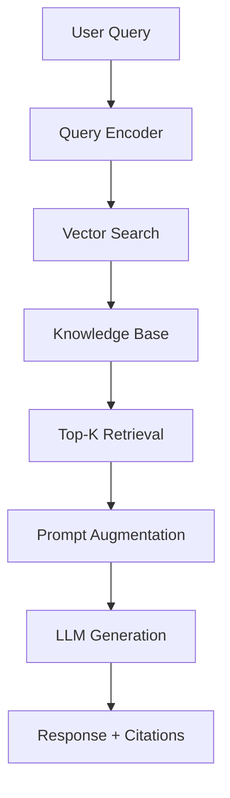

# RAG - Retrieval-Augmented Generation

## Overview

Retrieval-Augmented Generation (RAG) is a technique that enhances large language models by retrieving relevant information from external knowledge sources before generating responses. This approach combines the strengths of retrieval-based systems (accurate, up-to-date information) with generative models (natural language responses).

---

## Table of Contents
1. [What is RAG?](#what-is-rag)
2. [Why RAG Matters](#why-rag-matters)
3. [How RAG Works](#how-rag-works)
4. [RAG Components](#rag-components)
5. [Types of RAG](#types-of-rag)
6. [RAG vs Traditional Approaches](#rag-vs-traditional-approaches)
7. [Implementation Approaches](#implementation-approaches)
8. [Use Cases & Applications](#use-cases--applications)
9. [Challenges & Limitations](#challenges--limitations)
10. [Best Practices](#best-practices)
11. [Tools & Frameworks](#tools--frameworks)
12. [Performance Metrics](#performance-metrics)
13. [Advanced RAG Techniques](#advanced-rag-techniques)
14. [Building Your First RAG System](#building-your-first-rag-system)
15. [Future of RAG](#future-of-rag)
16. [Resources & Further Reading](#resources--further-reading)
17. [FAQ](#faq)

---

## What is RAG?

### Definition
RAG combines two key components:
- **Retrieval:** Finding relevant information from a knowledge base
- **Generation:** Using that information to generate coherent, contextual responses

### Key Innovation
Instead of relying solely on a model's trained parameters, RAG allows models to "look things up" before answering, providing:
- **Factual accuracy:** Grounded in real data, not just training patterns
- **Up-to-date information:** Can access current knowledge beyond training cutoff
- **Transparency:** Sources can be cited and verified
- **Scalability:** Use large knowledge bases without retraining the model

### Historical Context
- **2017:** Facebook AI introduces Memory Networks for question answering
- **2019:** DPR (Dense Passage Retrieval) paper shows dense retrieval outperforms sparse methods
- **2020:** RAG paper published by Facebook AI (now Meta)
- **2023-2026:** RAG becomes standard for enterprise AI applications

---

## Why RAG Matters

### The Problem with Pure Generation
Large language models have limitations:
- **Knowledge cutoff:** Information only up to training data
- **Hallucinations:** Confidently generate false information
- **Lack of grounding:** No way to verify or cite sources
- **Static knowledge:** Cannot learn new facts post-training

### RAG Solutions
- **Dynamic knowledge:** Access live, up-to-date information
- **Source attribution:** Cite where information comes from
- **Reduced hallucinations:** Ground responses in verifiable facts
- **Domain adaptation:** Easy to customize for specific domains
- **Cost-effective:** No need to retrain large models for new knowledge

### Market Impact (2026)
- **Adoption:** 70% of enterprise AI applications use RAG
- **Market size:** $2.5B+ in RAG-related tools and services
- **Growth:** 40% YoY growth in RAG implementations
- **Industries:** Healthcare, legal, finance, customer service leading adoption

---

## How RAG Works

### Basic RAG Pipeline

```
1. User Query → 2. Retrieve → 3. Augment → 4. Generate → 5. Response
```

#### Step 1: Query Processing
- User asks a question or makes a request
- Query is processed and potentially rewritten for better retrieval

#### Step 2: Retrieval
- Query is converted to vector embedding
- Similarity search finds relevant documents/chunks
- Top-k most relevant passages retrieved

#### Step 3: Augmentation
- Retrieved passages added to original prompt
- Context formatted for optimal model input
- May include re-ranking or filtering

#### Step 4: Generation
- LLM receives augmented prompt with query + context
- Generates response using both parametric knowledge and retrieved facts
- Response is grounded in provided context

#### Step 5: Post-processing
- Optional: Source attribution, confidence scoring
- Response delivered to user with citations

### Technical Flow Diagram


---

## RAG Components

### 1. Knowledge Base
- **Types:** Documents, databases, APIs, web content
- **Formats:** Text, structured data, multimedia
- **Sources:** Internal docs, public data, real-time APIs
- **Maintenance:** Regular updates, quality control, deduplication

### 2. Embedding Model
- **Purpose:** Convert text to vector representations
- **Popular models (2026):**
  - **text-embedding-3-large:** OpenAI's latest (3072 dimensions)
  - **text-embedding-ada-002:** OpenAI's previous (1536 dimensions)
  - **E5-large:** Microsoft's efficient model
  - **instructor-xl:** Tuned for specific domains
- **Considerations:** Dimension size, domain alignment, multilingual support

### 3. Vector Database
- **Function:** Store and search high-dimensional vectors
- **Popular options:**
  - **Pinecone:** Managed, scalable, easy to use
  - **Weaviate:** Open-source, hybrid search
  - **Milvus:** High-performance, distributed
  - **Chroma:** Lightweight, embedded
  - **Qdrant:** Rust-based, fast
- **Features:** Metadata filtering, hybrid search, real-time updates

### 4. Retrieval Algorithm
- **Dense retrieval:** Semantic similarity using embeddings
- **Sparse retrieval:** Keyword-based (BM25, TF-IDF)
- **Hybrid retrieval:** Combine dense + sparse for best results
- **Re-ranking:** Use cross-encoders to improve ranking

### 5. Large Language Model
- **Purpose:** Generate final response using retrieved context
- **Options:** GPT-4, Claude, Llama, Gemini
- **Considerations:** Context window size, cost, speed, quality

### 6. Orchestration Layer
- **Frameworks:** LangChain, LlamaIndex, Haystack
- **Functions:** Pipeline management, error handling, monitoring
- **Features:** Caching, fallback strategies, A/B testing

---

## Types of RAG

### 1. Naive RAG
- **Description:** Basic retrieve-then-generate approach
- **Pros:** Simple, fast, good baseline
- **Cons:** No optimization, may retrieve irrelevant information
- **Use case:** Prototyping, simple applications

### 2. Advanced RAG
- **Features:** Query rewriting, re-ranking, knowledge base optimization
- **Techniques:** Query expansion, multi-hop retrieval, fusion
- **Pros:** Better accuracy, handles complex queries
- **Cons:** More complex, higher latency
- **Use case:** Production applications requiring high accuracy

### 3. Modular RAG
- **Architecture:** Separate retrieval and generation modules
- **Benefits:** Independent optimization, easier debugging
- **Examples:** Different retrievers for different query types
- **Use case:** Complex enterprise applications

### 4. Graph RAG
- **Innovation:** Use knowledge graphs for structured retrieval
- **Benefits:** Better reasoning, relationship understanding
- **Challenges:** Graph construction and maintenance
- **Use case:** Scientific research, complex domain knowledge

### 5. Agentic RAG
- **Approach:** RAG system with agent capabilities
- **Features:** Multi-step reasoning, tool use, iterative refinement
- **Examples:** Web search integration, calculator usage
- **Use case:** Complex problem-solving, research tasks

### 6. Self-RAG
- **Innovation:** Model critiques and improves its own retrieval
- **Process:** Generate → Critique → Retrieve → Regenerate
- **Benefits:** Dynamic improvement, better quality control
- **Status:** Research stage (2026)

---

## RAG vs Traditional Approaches

| Aspect | Traditional LLM | Fine-tuned LLM | RAG |
|--------|----------------|----------------|-----|
| **Knowledge Updates** | Retrain model | Retrain model | Update knowledge base |
| **Cost** | High (training) | Medium (fine-tuning) | Low (indexing) |
| **Latency** | Fast | Fast | Medium (retrieval step) |
| **Accuracy** | Training data quality | Domain adaptation | Current information |
| **Explainability** | Black box | Black box | Source citations |
| **Scalability** | Fixed knowledge | Fixed knowledge | Dynamic knowledge |
| **Hallucinations** | Common | Reduced | Minimized |
| **Domain Adaptation** | Difficult | Medium | Easy |

---

## Implementation Approaches

### Basic RAG Implementation

```python
# Simple RAG with LangChain
from langchain.vectorstores import Chroma
from langchain.embeddings import OpenAIEmbeddings
from langchain.llms import OpenAI
from langchain.chains import RetrievalQA

# 1. Load documents
documents = load_documents("knowledge_base/")

# 2. Create embeddings and vector store
embeddings = OpenAIEmbeddings()
vectorstore = Chroma.from_documents(documents, embeddings)

# 3. Create retrieval chain
qa_chain = RetrievalQA.from_chain_type(
    llm=OpenAI(),
    chain_type="stuff",
    retriever=vectorstore.as_retriever()
)

# 4. Query
result = qa_chain.run("What is RAG?")
```

### Advanced RAG with LlamaIndex

```python
from llama_index import VectorStoreIndex, SimpleDirectoryReader
from llama_index.llms import OpenAI

# Load documents
documents = SimpleDirectoryReader("data").load_data()

# Create index
index = VectorStoreIndex.from_documents(documents)

# Query with citations
query_engine = index.as_query_engine(
    similarity_top_k=3,
    response_mode="tree_summarize"
)

response = query_engine.query("Explain RAG architecture")
print(response)  # Includes source citations
```

### Production RAG Pipeline

```python
# Production setup with monitoring
from langchain.document_loaders import DirectoryLoader
from langchain.text_splitter import RecursiveCharacterTextSplitter
from langchain.vectorstores import Pinecone
from langchain.chains import ConversationalRetrievalChain

# Document processing pipeline
def create_rag_pipeline():
    # Load and split documents
    loader = DirectoryLoader("docs/", glob="**/*.md")
    documents = loader.load()
    
    text_splitter = RecursiveCharacterTextSplitter(
        chunk_size=1000,
        chunk_overlap=200
    )
    splits = text_splitter.split_documents(documents)
    
    # Create vector store
    vectorstore = Pinecone.from_documents(
        splits, 
        embeddings, 
        index_name="rag-index"
    )
    
    # Create chain with memory
    chain = ConversationalRetrievalChain.from_llm(
        llm=OpenAI(temperature=0),
        retriever=vectorstore.as_retriever(),
        memory=ConversationBufferMemory()
    )
    
    return chain
```

---

## Use Cases & Applications

### Enterprise Applications

#### Customer Support
- **Problem:** Inconsistent answers, outdated information
- **RAG Solution:** Retrieve from knowledge base + generate personalized responses
- **Impact:** 40% reduction in support tickets, 95%+ accuracy
- **Examples:** Zendesk AI, Salesforce Einstein

#### Legal Research
- **Use case:** Contract analysis, precedent research, compliance checking
- **Benefits:** Access to current case law, faster research
- **Tools:** LexisNexis AI, Thomson Reuters RAG systems

#### Healthcare
- **Applications:** Clinical decision support, medical literature review
- **Benefits:** Up-to-date treatment guidelines, reduced errors
- **Examples:** IBM Watson Health, Epic Systems AI

### Content & Education

#### Educational Assistants
- **Function:** Answer student questions using course materials
- **Benefits:** Consistent answers, 24/7 availability
- **Examples:** Duolingo AI tutor, Coursera assistants

#### Content Generation
- **Use case:** Marketing copy, technical documentation
- **Approach:** Retrieve brand guidelines + generate content
- **Benefits:** Brand consistency, faster creation

### Research & Analysis

#### Scientific Research
- **Application:** Literature review, hypothesis generation
- **Benefits:** Access to latest papers, cross-disciplinary insights
- **Tools:** Semantic Scholar, ResearchRabbit

#### Market Intelligence
- **Use case:** Competitive analysis, trend identification
- **Data sources:** News, social media, financial reports
- **Benefits:** Real-time insights, comprehensive coverage

### Creative Applications

#### Code Generation
- **Approach:** Retrieve relevant code snippets + generate new code
- **Benefits:** Context-aware suggestions, library integration
- **Examples:** GitHub Copilot (uses retrieval), Cursor AI

#### Design Assistance
- **Use case:** UI/UX suggestions, brand guidelines
- **Benefits:** Consistent design language, accessibility compliance

---

## Challenges & Limitations

### 1. Retrieval Quality
- **Challenge:** Finding the right information among millions of documents
- **Issues:** Semantic mismatch, outdated information, irrelevant results
- **Solutions:** Better embeddings, re-ranking, query expansion

### 2. Latency
- **Problem:** Retrieval step adds time to response
- **Typical latency:** 200-500ms for retrieval + 1-3s for generation
- **Solutions:** Caching, approximate search, async retrieval

### 3. Context Window Limitations
- **Issue:** Retrieved content may exceed model's context window
- **Limits:** GPT-4: 32k tokens, Claude: 200k tokens (2026)
- **Solutions:** Chunking strategies, summarization, selective retrieval

### 4. Knowledge Base Quality
- **Problems:** Outdated info, biased sources, incomplete coverage
- **Maintenance:** Regular updates, quality control, deduplication
- **Cost:** Significant effort to maintain high-quality knowledge bases

### 5. Hallucinations Still Possible
- **Remaining issues:** Model can still hallucinate even with context
- **Causes:** Poor retrieval, ambiguous context, model limitations
- **Mitigation:** Confidence scoring, fact-checking, human oversight

### 6. Scalability
- **Challenges:** Large knowledge bases, high query volume
- **Solutions:** Distributed systems, efficient indexing, caching layers

### 7. Security & Privacy
- **Risks:** Sensitive information in responses, data leakage
- **Concerns:** PII exposure, proprietary information disclosure
- **Solutions:** Access controls, data sanitization, audit trails

---

## Best Practices

### Knowledge Base Construction

#### Document Preparation
- **Chunking strategy:** 500-1000 tokens with 10-20% overlap
- **Metadata:** Include source, date, author, category
- **Quality control:** Remove duplicates, verify accuracy
- **Updates:** Regular refresh schedule, version control

#### Embedding Selection
- **Domain alignment:** Use embeddings trained on similar domains
- **Multilingual:** Consider language requirements
- **Dimensionality:** Balance between quality and speed (768-3072 dimensions)
- **Evaluation:** Test retrieval quality on domain-specific queries

### Retrieval Optimization

#### Query Processing
- **Query expansion:** Add synonyms, related terms
- **Query rewriting:** Rephrase for better retrieval
- **Multi-query:** Generate multiple query variations
- **Hybrid search:** Combine semantic + keyword search

#### Ranking & Filtering
- **Re-ranking:** Use cross-encoders for better relevance
- **Diversity:** Ensure diverse sources, avoid redundancy
- **Recency:** Boost recent information when relevant
- **Authority:** Weight by source credibility

### Generation Optimization

#### Prompt Engineering
- **Context formatting:** Clear separation between query and context
- **Instructions:** Explicit guidelines for using retrieved information
- **Citation requirements:** Ask model to cite sources
- **Persona:** Define helpful, accurate assistant role

#### Response Quality
- **Fact-checking:** Include verification steps
- **Confidence scores:** Indicate uncertainty when appropriate
- **Fallbacks:** Handle cases where retrieval fails
- **Length control:** Appropriate response length for use case

### Production Considerations

#### Monitoring & Maintenance
- **Metrics tracking:** Retrieval accuracy, response quality, latency
- **A/B testing:** Compare different configurations
- **Feedback loops:** User corrections improve system
- **Drift detection:** Monitor for changing query patterns

#### Scalability & Performance
- **Caching:** Cache frequent queries and embeddings
- **Async processing:** Parallel retrieval and generation
- **Load balancing:** Distribute across multiple instances
- **Cost optimization:** Balance quality vs. compute costs

---

## Tools & Frameworks

### Open-Source Frameworks

#### LangChain
- **Purpose:** Complete RAG pipeline orchestration
- **Features:** Document loaders, text splitters, vector stores, chains
- **Strengths:** Most popular, extensive integrations
- **Language:** Python, JavaScript

#### LlamaIndex (formerly GPT Index)
- **Focus:** Data ingestion and indexing for LLMs
- **Features:** Advanced indexing, query engines, multi-modal support
- **Strengths:** Data-centric approach, good documentation
- **Language:** Python

#### Haystack
- **Purpose:** End-to-end NLP pipelines
- **Features:** Pre-built components, evaluation tools
- **Strengths:** Production-ready, scalable
- **Language:** Python

#### ChromaDB
- **Purpose:** Lightweight vector database
- **Features:** Embedded, easy setup, metadata filtering
- **Strengths:** Simple, fast for small projects
- **Language:** Python

### Commercial Platforms

#### Pinecone
- **Type:** Managed vector database
- **Features:** Serverless, scalable, hybrid search
- **Pricing:** Pay per usage, free tier available
- **Integrations:** LangChain, LlamaIndex

#### Weaviate
- **Type:** Vector database with hybrid search
- **Features:** GraphQL API, real-time updates
- **Pricing:** Open-source core, cloud hosting
- **Strengths:** Rich querying capabilities

#### Vespa
- **Type:** Big data serving engine
- **Features:** Real-time indexing, tensor computations
- **Strengths:** High performance at scale
- **Use case:** Large-scale production systems

### Cloud Services

#### Azure Cognitive Search
- **Features:** Hybrid search, AI enrichment, scaling
- **Integrations:** Azure OpenAI, Azure AI services
- **Strengths:** Enterprise features, compliance

#### AWS Kendra
- **Features:** Intelligent search, natural language queries
- **Integrations:** AWS ecosystem, S3, RDS
- **Strengths:** Enterprise security, scalability

#### Google Cloud Search AI
- **Features:** Multimodal search, generative AI integration
- **Integrations:** Vertex AI, BigQuery
- **Strengths:** Google's AI capabilities

---

## Performance Metrics

### Retrieval Metrics

#### Precision@K
- **Definition:** Fraction of retrieved documents that are relevant
- **Formula:** Precision@K = (Relevant documents in top K) / K
- **Target:** >0.8 for good performance

#### Recall@K
- **Definition:** Fraction of relevant documents retrieved in top K
- **Formula:** Recall@K = (Relevant documents in top K) / (Total relevant documents)
- **Target:** >0.7 for comprehensive retrieval

#### Mean Reciprocal Rank (MRR)
- **Definition:** Average of reciprocal ranks of first relevant document
- **Formula:** MRR = (1/Q) Σ(1/rank_i)
- **Target:** >0.8 for good ranking

#### Normalized Discounted Cumulative Gain (NDCG)
- **Definition:** Measures ranking quality with position-based discounting
- **Target:** >0.85 for excellent ranking

### Generation Metrics

#### Factual Accuracy
- **Definition:** Percentage of claims that are factually correct
- **Measurement:** Human evaluation or automated fact-checking
- **Target:** >95% for production systems

#### Citation Accuracy
- **Definition:** Citations actually support the claims made
- **Measurement:** Manual verification
- **Target:** >98% citation accuracy

#### Response Quality
- **Coherence:** Logical flow and consistency
- **Completeness:** Addresses all aspects of query
- **Helpfulness:** Provides actionable information

### System Metrics

#### Latency
- **Retrieval:** <200ms for good UX
- **Generation:** <2s for conversational
- **Total end-to-end:** <3s target

#### Throughput
- **Queries per second:** Depends on use case (10-1000+ QPS)
- **Concurrent users:** Scale with infrastructure

#### Cost Metrics
- **Per query cost:** Track embedding + LLM costs
- **Optimization:** Balance quality vs. cost
- **Break-even analysis:** Compare with alternatives

---

## Advanced RAG Techniques

### 1. Query Routing
- **Concept:** Route queries to different retrieval strategies
- **Implementation:** Classifier determines query type (factual, analytical, creative)
- **Benefits:** Optimized retrieval for different query types

### 2. Multi-Hop Retrieval
- **Process:** Use initial retrieval to inform follow-up queries
- **Example:** Find person → Find their publications → Find related work
- **Benefits:** Better for complex, multi-step reasoning

### 3. Knowledge Graph Integration
- **Approach:** Combine vector search with graph traversal
- **Benefits:** Understand relationships, better reasoning
- **Tools:** Neo4j + vector databases

### 4. Adaptive Retrieval
- **Concept:** Learn from user feedback to improve retrieval
- **Implementation:** Reinforcement learning on retrieval decisions
- **Benefits:** Continuous improvement

### 5. Memory-Augmented RAG
- **Purpose:** Maintain conversation context across sessions
- **Implementation:** Persistent memory store with summarization
- **Benefits:** Long-term relationship building

### 6. Multimodal RAG
- **Capabilities:** Handle text, images, audio, video
- **Models:** CLIP for images, Whisper for audio
- **Applications:** Visual question answering, audio analysis

### 7. Federated RAG
- **Concept:** Retrieve from multiple distributed knowledge bases
- **Benefits:** Privacy-preserving, scalable
- **Challenges:** Coordination, consistency

---

## Building Your First RAG System

### Prerequisites
- Python 3.8+
- OpenAI API key (or alternative LLM)
- Basic understanding of Python and APIs

### Step 1: Environment Setup
```bash
# Create virtual environment
python -m venv rag-env
source rag-env/bin/activate

# Install dependencies
pip install langchain openai chromadb tiktoken
```

### Step 2: Prepare Knowledge Base
```python
# Create sample documents
documents = [
    "RAG combines retrieval and generation for better AI responses.",
    "Retrieval finds relevant information from a knowledge base.",
    "Generation creates natural language responses using retrieved context.",
    "RAG reduces hallucinations by grounding responses in facts."
]

# Save to files
import os
os.makedirs("data", exist_ok=True)
for i, doc in enumerate(documents):
    with open(f"data/doc_{i}.txt", "w") as f:
        f.write(doc)
```

### Step 3: Build Basic RAG Pipeline
```python
from langchain.document_loaders import DirectoryLoader
from langchain.text_splitter import CharacterTextSplitter
from langchain.embeddings import OpenAIEmbeddings
from langchain.vectorstores import Chroma
from langchain.llms import OpenAI
from langchain.chains import RetrievalQA

# Load documents
loader = DirectoryLoader("data/", glob="**/*.txt")
documents = loader.load()

# Split documents
text_splitter = CharacterTextSplitter(chunk_size=500, chunk_overlap=50)
texts = text_splitter.split_documents(documents)

# Create embeddings and vector store
embeddings = OpenAIEmbeddings()
vectorstore = Chroma.from_documents(texts, embeddings)

# Create RAG chain
qa_chain = RetrievalQA.from_chain_type(
    llm=OpenAI(temperature=0.1),
    chain_type="stuff",
    retriever=vectorstore.as_retriever(search_kwargs={"k": 3})
)

# Test it
query = "What is RAG and how does it work?"
result = qa_chain.run(query)
print(result)
```

### Step 4: Add Improvements
```python
# Add conversation memory
from langchain.memory import ConversationBufferMemory

memory = ConversationBufferMemory(
    memory_key="chat_history",
    return_messages=True
)

# Create conversational RAG
qa_chain = ConversationalRetrievalChain.from_llm(
    llm=OpenAI(temperature=0.1),
    retriever=vectorstore.as_retriever(),
    memory=memory
)

# Add source citations
def get_answer_with_sources(query):
    docs = vectorstore.similarity_search(query, k=3)
    context = "\n".join([doc.page_content for doc in docs])
    
    prompt = f"""
    Answer the question based on the following context:
    {context}
    
    Question: {query}
    
    Include citations to the source documents in your answer.
    """
    
    response = OpenAI().predict(prompt)
    return response, [doc.metadata.get('source', 'Unknown') for doc in docs]
```

### Step 5: Deploy and Monitor
```python
# Simple Flask API
from flask import Flask, request, jsonify

app = Flask(__name__)

@app.route('/query', methods=['POST'])
def query():
    data = request.json
    question = data['question']
    
    # Get answer with sources
    answer, sources = get_answer_with_sources(question)
    
    return jsonify({
        'answer': answer,
        'sources': sources,
        'timestamp': str(datetime.now())
    })

if __name__ == '__main__':
    app.run(debug=True)
```

### Step 6: Evaluate and Improve
```python
# Basic evaluation
test_questions = [
    "What is RAG?",
    "How does retrieval work?",
    "What are the benefits of RAG?"
]

for question in test_questions:
    answer, sources = get_answer_with_sources(question)
    print(f"Q: {question}")
    print(f"A: {answer}")
    print(f"Sources: {sources}")
    print("---")
```

---

## Future of RAG

### Near-term Developments (2026-2028)

#### Enhanced Retrieval
- **Better embeddings:** Multimodal, domain-specific models
- **Graph-based retrieval:** Knowledge graphs + vectors
- **Real-time indexing:** Streaming data integration
- **Federated search:** Privacy-preserving cross-organization search

#### Advanced Generation
- **Longer context:** 1M+ token context windows
- **Multimodal output:** Text + images + charts
- **Structured generation:** JSON, code, mathematical proofs
- **Self-improving systems:** RAG that learns from interactions

#### Agent Integration
- **RAG agents:** Autonomous systems with RAG capabilities
- **Multi-agent RAG:** Teams of specialized RAG systems
- **Tool integration:** RAG systems that use calculators, APIs, databases

### Medium-term (2028-2032)

#### AGI Integration
- **RAG as AGI component:** Memory and reasoning augmentation
- **Self-evolving knowledge:** Systems that expand their own knowledge bases
- **Cross-modal understanding:** Unified understanding across text, vision, audio

#### Enterprise Transformation
- **Knowledge worker augmentation:** RAG assistants for every profession
- **Automated research:** Scientific discovery acceleration
- **Personalized education:** Adaptive learning systems

### Research Frontiers

#### Theoretical Advances
- **Optimal retrieval strategies:** Mathematical foundations
- **Knowledge representation:** Better ways to structure information
- **Reasoning with retrieval:** Multi-hop, causal reasoning

#### Technical Challenges
- **Scalability:** Billion+ document knowledge bases
- **Real-time performance:** Sub-millisecond retrieval
- **Energy efficiency:** Sustainable large-scale RAG

#### Safety & Alignment
- **Truthful RAG:** Guaranteed factual responses
- **Bias mitigation:** Fair and unbiased retrieval
- **Privacy-preserving RAG:** Secure knowledge sharing

---

## Resources & Further Reading

### Academic Papers

#### Foundational Papers
- **"Retrieval-Augmented Generation for Knowledge-Intensive NLP Tasks"** (Lewis et al., 2020)
  - Original RAG paper introducing the concept
- **"Dense Passage Retrieval for Open-Domain Question Answering"** (Karpukhin et al., 2020)
  - DPR: Foundation for modern dense retrieval
- **"REALM: Retrieval-Augmented Language Model Pre-Training"** (Guu et al., 2020)
  - End-to-end retrieval during pre-training

#### Advanced Techniques
- **"Self-RAG: Learning to Retrieve, Generate, and Critique through Self-Reflection"** (Asai et al., 2023)
  - Self-improving RAG systems
- **"Generate rather than Retrieve: Large Language Models are Strong Context Generators"** (Mallen et al., 2023)
  - Alternative to traditional retrieval
- **"RA-DIT: Retrieval-Augmented Dual Instruction Tuning"** (Gao et al., 2023)
  - Better instruction tuning for RAG

### Books & Guides

#### Practical Guides
- **"Building LLM Applications for Production"** (Hannes Hapke & Jason Liu)
  - Includes comprehensive RAG chapters
- **"Retrieval-Augmented Generation (RAG) Handbook"** (Various authors)
  - Collection of RAG techniques and best practices

#### Technical Deep Dives
- **"Neural Information Retrieval"** (Bhaskar Mitra & Nick Craswell)
  - Theoretical foundations of retrieval
- **"Embeddings in Natural Language Processing"** (Mohammad Taher Pilehvar)
  - Understanding embeddings for RAG

### Online Resources

#### Tutorials & Courses
- **LangChain RAG Tutorials:** https://python.langchain.com/docs/use_cases/question_answering/
- **LlamaIndex Guides:** https://docs.llamaindex.ai/
- **Pinecone Learn:** https://www.pinecone.io/learn/
- **DeepLearning.AI RAG Course:** Specialized RAG curriculum

#### Communities
- **r/RAG:** Reddit community for RAG discussions
- **RAG Discord:** Community of practitioners
- **Papers with Code - RAG:** Implementation collections
- **Hugging Face RAG Section:** Models and datasets

#### Tools & Platforms
- **RAG Evaluation Toolkit:** https://github.com/explodinggradients/ragas
- **RAG Benchmark Datasets:** BEIR, NaturalQuestions, TriviaQA
- **RAG Monitoring Tools:** Arize AI, Weights & Biases

### Conferences & Events
- **NeurIPS:** Annual machine learning conference
- **ICML:** International Conference on Machine Learning
- **ACL:** Association for Computational Linguistics
- **SIGIR:** Information Retrieval conference

---

## FAQ

**Q: What's the difference between RAG and fine-tuning?**
A: Fine-tuning updates the model's parameters for specific knowledge. RAG keeps the model general but provides relevant context at inference time. RAG is cheaper, more flexible, and allows dynamic knowledge updates.

**Q: Can RAG work with any LLM?**
A: Yes, RAG is model-agnostic. It works with GPT, Claude, Llama, or any LLM that can process context. The retrieval component is separate from the generation model.

**Q: How much does RAG cost to implement?**
A: Basic setup: $50-500 for small projects. Production system: $5K-50K+ depending on scale. Costs include: embedding API calls, vector database, LLM usage, and infrastructure.

**Q: What's the latency impact of RAG?**
A: Typically adds 200-500ms for retrieval. Total response time: 1-3 seconds. Can be optimized with caching, approximate search, and async processing.

**Q: How do I choose chunk size for documents?**
A: 500-1000 tokens is common. Smaller chunks (256 tokens) for precise retrieval. Larger chunks (2048 tokens) for more context. Test different sizes on your use case.

**Q: Can RAG handle real-time data?**
A: Yes, with streaming ingestion and real-time indexing. Tools like Pinecone support real-time updates. For very high-frequency data, consider hybrid approaches.

**Q: What's the biggest limitation of RAG?**
A: Retrieval quality determines overall performance. Poor retrieval leads to poor answers. Invest time in optimizing embeddings, chunking, and ranking.

**Q: How do I evaluate RAG system performance?**
A: Use metrics like retrieval precision/recall, answer accuracy, citation correctness. Human evaluation for subjective quality. Automated metrics for factual correctness.

**Q: Can RAG replace traditional search engines?**
A: Not entirely. RAG excels at conversational, explanatory responses. Search engines are better for broad discovery and ranking. Best used complementarily.

**Q: What's the future of RAG?**
A: More integrated with agent systems, multimodal capabilities, real-time knowledge updates, and self-improving retrieval. Will become standard for enterprise AI applications.

**Q: How do I handle sensitive information in RAG?**
A: Implement access controls, data sanitization, and audit trails. Use private vector databases. Consider on-premise deployment for highly sensitive data.

**Q: Can RAG work offline?**
A: Yes, with local models and vector databases. Use open-source embeddings (Sentence Transformers) and local LLMs (Llama.cpp, GPT4All) for fully offline RAG.

**Q: What's the difference between RAG and semantic search?**
A: Semantic search finds relevant documents. RAG takes it further by generating natural language responses based on those documents, with proper context and citations.

**Q: How do I scale RAG to millions of documents?**
A: Use distributed vector databases (Pinecone, Weaviate), implement hierarchical indexing, use approximate nearest neighbor search, and consider sharding strategies.

**Q: Can RAG generate creative content?**
A: Yes, but it's most effective for factual, informative content. For pure creativity, traditional generation might be better. RAG can enhance creativity by providing factual grounding.

---

*Last updated: April 2026*</content>
<parameter name="filePath">/home/nagamaiah/coding/AI-Notes/RAG/README.md