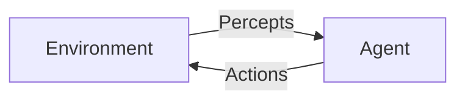

# ai-agents

## AI Workflows
- Traditional AI workflows involve data collection, preprocessing, model training, evaluation, and deployment.
- They only follow pre-defined control logic and dependent on manual intervention.
- To overcome the limitations of traditional workflows, AI agents can automate many of these steps, allowing for more dynamic and adaptive systems.

## What are AI Agents?
- AI agent that uses Artificial Intelligence to make decisions and take actions on it's own.
- AI agents are autonomous entities that perceive their environment, reason about it, and take actions to achieve specific goals.
- They can range from simple rule-based bots to advanced, learning-enabled systems that adapt over time.

---

## Table of Contents
1. [What are AI Agents](#what-are-ai-agents)
2. [Types of AI Agents](#types-of-ai-agents)
3. [Agent Architectures](#agent-architectures)
4. [Key Concepts](#key-concepts)
5. [RAG - Retrieval Augmented Generation](#rag-retrieval-augmented-generation)
6. [Use Cases](#use-cases)
7. [Popular Frameworks](#popular-frameworks)
8. [Building Your First Agent](#building-your-first-agent)
9. [Safety & Ethics](#safety--ethics-in-ai-agents)
10. [Performance Metrics](#performance-metrics)
11. [Common Mistakes](#common-mistakes)
12. [Best Practices](#best-practices)
13. [Challenges & Solutions](#challenges--solutions)
14. [Future Trends](#future-trends)
15. [Agents vs Traditional Systems](#agents-vs-traditional-systems)
16. [Additional Resources](#additional-resources)
17. [Further Reading](#further-reading)
18. [FAQ](#faq)

---

## Types of AI Agents

### 1. Simple Reflex Agents
- Act only on current percept, ignoring history
- Use condition-action rules (if-then)
- Examples: Thermostats, simple game AI
- Pros: Fast, easy to implement, low cost
- Cons: Limited to reactive behavior
- Best for: Real-time systems, simple environments

### 2. Model-Based Reflex Agents
- Maintain internal state to track world
- Update state based on percepts and actions
- Examples: Chess bots, navigation systems
- Pros: Handle partial observability
- Cons: Requires accurate model
- Best for: Partially observable environments

### 3. Goal-Based Agents
- Define goals, work toward them via planning
- Use search and planning algorithms
- Examples: Path planning, resource allocation
- Pros: Flexible, handles multiple objectives
- Cons: Planning is computationally expensive
- Best for: Long-term planning

### 4. Utility-Based Agents
- Choose actions based on utility function
- Maximize expected utility
- Examples: Recommendation systems, autonomous vehicles
- Pros: Makes trade-offs optimally
- Cons: Requires accurate utility function
- Best for: Complex decision-making

### 5. Learning Agents
- Improve performance over time
- Learn from experience and feedback
- Examples: ChatGPT, AlphaGo, recommenders
- Pros: Adapt to environments, improve continuously
- Cons: Needs data, slow initial learning
- Best for: Long-term applications, complex domains

---

## Agent Architectures

### 1. Reactive Architecture
- Direct stimulus-response mapping
- No planning, immediate action
- Examples: Thermostats, traffic sensors
- Pros: Fast, simple, robust
- Cons: Limited to simple behaviors
- Use when: Speed critical, simple problem

### 2. Deliberative Architecture
- Symbolic reasoning and explicit planning
- Components: Perception → Knowledge → Reasoning → Action
- Examples: Expert systems, planners
- Pros: Complex reasoning, explainable
- Cons: Slow, needs accurate model
- Use when: Optimal solutions matter

### 3. Hybrid Architecture
- Combines reactive and deliberative
- Fast response + planning capability
- Examples: SOAR, BDI agents
- Pros: Speed and sophistication
- Cons: Complex, harder to debug
- Use when: Need both speed and reasoning

### 4. Layered Architecture
- Hierarchical organization
- Each layer has specific role
- Used in: Robotics, autonomous systems
- Pros: Modular, scalable, handles complexity
- Cons: Layer coordination challenges
- Use when: Hierarchical control needed

---

## Key Concepts

### Core Components
- **Perception:** Gathering information via sensors or APIs
  - Types: Direct sensing, event streams, API calls
  - Challenge: Partial observability (incomplete info)
  - Solution: Maintain internal model to infer hidden state

- **Action:** Executing operations that affect environment
  - Types: Physical (robots), digital (APIs), info (messages)
  - Constraints: Limited action space, action costs
  - Effect: Changes environment state

- **Reasoning/Decision:** Strategy to determine actions
  - Methods: Rule-based, search-based, learning-based
  - Constraint: Real-time vs. deliberation time
  - Uncertainty: Dealing with incomplete information

- **Reward/Utility:** Feedback to evaluate actions
  - Types: Immediate vs. long-term utility
  - Design: Aligning reward with desired behavior
  - Challenge: Reward hacking (exploiting metric)

- **Learning:** Adapting behavior based on experience
  - Methods: Reinforcement, supervised, unsupervised learning
  - Transfer learning: Applying knowledge from past tasks
  - Continual learning: Learning without forgetting

### Advanced Concepts
- **State Space:** All possible world configurations
- **Action Space:** All possible actions agent can take
- **Policy:** Mapping from states to actions (agent's strategy)
- **Value Function:** Expected utility from each state
- **Environment Model:** Agent's internal representation of world
- **Exploration vs. Exploitation:** Balance between trying new things vs. using known solutions
- **Planning Horizon:** How far ahead agent thinks
- **Partial Observability:** Agent doesn't see full world state
- **Non-Determinism:** Actions have uncertain outcomes


## RAG (Retrieval-Augmented Generation)

RAG enables AI agents to "look things up" before inferring, combining retrieval with generation for better answers.

### How RAG Works
1. **Query:** Agent receives question/task
2. **Retrieve:** Search knowledge base for relevant info
3. **Augment:** Add retrieved context to prompt
4. **Generate:** LLM generates response using context + training
5. **Return:** Present grounded answer

### Benefits
- **Accuracy:** Access up-to-date, domain-specific info
- **Factuality:** Reduce hallucinations by grounding in facts
- **Scalability:** Use large knowledge bases without retraining
- **Transparency:** Show sources for answers
- **Cost:** Cheaper than retraining models

### Components
- **Retriever:** Fast search for relevant documents
  - Vector databases: Pinecone, Weaviate, Milvus
  - Keyword search: Elasticsearch, Solr
  - Hybrid: Combine both approaches

- **Generator:** LLM that produces final answer
  - Can be fine-tuned or few-shot
  - Should effectively use context

- **Knowledge Base:**
  - Documents, papers, wikis, databases
  - Needs indexing and embeddings
  - Regular updates for freshness

### Use Cases
- **Question Answering:** Support, knowledge assistance
- **Summarization:** With facts and citations
- **Code Generation:** Retrieve relevant code snippets
- **Information Retrieval:** Search and recommendation
- **Long-context:** Handle documents too long for model

### Challenges
- Retrieval quality: Bad retrieval → bad generation
- Ranking: Choosing top-k relevant docs
- Latency: Retrieval adds time overhead
- Storage: Maintaining large knowledge bases
- Staleness: Keeping info up-to-date

### Best Practices
- Use domain-aligned embedding models
- Implement re-ranking for better relevance
- Cache frequent queries
- Version control knowledge base
- Monitor retrieval quality
- Use multiple retrieval methods

## An AI Agent is a system that:
- Perceives (takes input from the world),
- Thinks (decides what to do using AI),
- Acts (takes some action),
- Learns (improves over time – sometimes).


---

## Use Cases

### Virtual Assistants
- Examples: Siri, Alexa, Google Assistant, ChatGPT
- Capabilities: Voice recognition, NLP, task automation
- Business impact: $5-10B market, growing 25% yearly
- Challenges: Privacy, context awareness, multi-step tasks

### Automated Trading Bots
- Examples: Algorithmic trading systems, crypto bots
- Capabilities: Market analysis, real-time decision-making
- Performance: Can execute trades in microseconds
- Risks: Market volatility, regulatory oversight, flash crashes

### Game AI
- Examples: NPCs, opponents, procedural generation
- Types: Pathfinding, behavior trees, learning AI
- Impact: Better player experience, reduced development
- Trends: Increasingly using deep learning (AlphaGo, ChatGPT)

### Robotics
- Examples: Manufacturing, warehouse, exploration robots
- Tasks: Navigation, manipulation, swarm coordination
- Benefits: Increased productivity, dangerous task automation
- Challenges: Real-time constraints, physical world complexity

### Customer Support Chatbots
- Examples: FAQ bots, support agents, sales assistants
- Impact: 70% reduction in support costs, 24/7 availability
- Capabilities: NLP, intent classification, knowledge lookup
- Limitation: Still require human escalation for complex issues

### Recommendation Systems
- Examples: Netflix, Amazon, Spotify recommendations
- Methods: Collaborative filtering, content-based, hybrid
- Impact: 35% of Netflix revenue from recommendations
- Challenge: Cold-start problem, polarization

### Autonomous Vehicles
- Examples: Self-driving cars, delivery drones
- Components: Perception, planning, control
- Progress: Level 3-4 autonomy now available
- Challenges: Safety, regulatory approval, edge cases

---

## Popular Frameworks

### LangChain
- **Purpose:** Building LLM-powered agents and chains
- **Features:** Agent orchestration, memory management, tool use
- **Language:** Python, JavaScript
- **Best for:** Rapid agent development, LLM applications
- **Stars:** 80k+ GitHub stars
- **Example:** Create agents that use tools like calculators, search

### Auto-GPT
- **Purpose:** Autonomous GPT-4 agents
- **Features:** Goal setting, memory, tool integration
- **Language:** Python
- **Best for:** Autonomous task execution
- **Note:** Experimental, high token costs

### Microsoft Semantic Kernel
- **Purpose:** Orchestrating AI skills and plugins
- **Features:** Skill composition, semantic functions, memory
- **Languages:** C#, Python, Java, JavaScript
- **Best for:** Enterprise AI applications
- **Integration:** Works with Azure services

### OpenAI Gym
- **Purpose:** Reinforcement learning environments
- **Features:** Standard RL benchmarks, simplification
- **Language:** Python
- **Use:** Training and evaluating RL agents
- **Successor:** Gymnasium (modern version)

### Rasa
- **Purpose:** Conversational AI and chatbots
- **Features:** NLU, dialogue management, multi-channel
- **Language:** Python
- **Best for:** Building production chatbots
- **Deployment:** Cloud or on-premise

### Other Notable Frameworks
- **CrewAI:** Multi-agent collaboration
- **Autogen:** Multi-agent conversation
- **Agents from Claude:** High-level agent APIs
- **Hugging Face Agent:** Unified agent interface
- **Ray RLlib:** Distributed reinforcement learning

---

## Example: Simple Python Agent
```python
class SimpleAgent:
    def __init__(self, name):
        self.name = name
    def perceive(self, environment):
        print(f"{self.name} perceives: {environment}")
    def act(self):
        print(f"{self.name} takes an action!")

agent = SimpleAgent("Agent007")
agent.perceive("an open door")
agent.act()
```

---

## Best Practices

### 1. Define Clear Goals
- Make goals specific, measurable, achievable
- Align with business objectives
- Break large goals into subgoals
- Communicate goals to stakeholders

### 2. Use Modular Design
- Separate concerns (perception, reasoning, action)
- Make components reusable
- Enable independent testing
- Easier debugging and maintenance

### 3. Monitor and Log
- Log important decisions and reasoning
- Track metrics: success rate, latency, errors
- Use observability tools (Datadog, New Relic)
- Detect anomalies early
- Enable post-mortem analysis

### 4. Test Thoroughly
- Test in simulated environments first
- Use synthetic data for scenarios
- Incremental real-world rollout
- A/B test against baselines
- Monitor for edge cases

### 5. Ensure Safety
- Implement safety constraints
- Have kill switches for critical agents
- Regular audits and reviews
- Align with human values
- Get proper regulatory approval

### 6. Design Reward Functions
- Align rewards with desired behavior
- Avoid reward hacking
- Consider long-term vs. short-term rewards
- Test reward function thoroughly
- Iterate based on real results

### 7. Handle Uncertainty
- Implement confidence scores
- Have fallbacks for failures
- Gather more data when uncertain
- Ask for human help when needed
- Explain uncertainty to users

### 8. Version and Control
- Version all agent code
- Track model/checkpoint versions
- Document changes and rationale
- Enable rollback when needed
- Maintain reproducibility

---

## Challenges & Solutions

### 1. Partial Observability
- **Challenge:** Agent doesn't see full world state
- **Solutions:** Internal state models, probabilistic reasoning, information gathering

### 2. Non-Deterministic Environments
- **Challenge:** Same action has different outcomes
- **Solutions:** Stochastic models, plan for multiple outcomes, robustness testing

### 3. Exploration vs. Exploitation
- **Challenge:** Balance trying new things vs. known solutions
- **Solutions:** Epsilon-greedy, UCB, Thompson sampling strategies

### 4. Real-Time Decision Making
- **Challenge:** Limited time to decide
- **Solutions:** Reactive strategies, pre-computation, anytime algorithms

### 5. Safety and Alignment
- **Challenge:** Ensure behavior aligns with human values
- **Solutions:** Careful reward design, constraints, audits, human oversight

### 6. Scalability
- **Challenge:** Complexity grows with state/action space
- **Solutions:** Function approximation, hierarchical planning, distributed agents

### 7. Learning Data Requirements
- **Challenge:** Learning needs lots of data
- **Solutions:** Transfer learning, simulation, few-shot learning, active learning

### 8. Interpretability
- **Challenge:** Hard to explain decisions
- **Solutions:** Interpretable models, explanations, decomposition, logging

---

## Building Your First Agent

### Step 1: Define Your Problem
- What problem are you solving? (automation, decision-making, interaction)
- What's the expected input/output?
- What metrics define success?
- Who are the end users?
- What constraints exist? (latency, cost, resources)

### Step 2: Choose Your Architecture
- **Simple problems:** Use reactive or reflex agents
- **Planning problems:** Use deliberative or goal-based agents
- **Learning problems:** Use learning/utility-based agents
- **Hybrid:** Use layered or hybrid architecture
- Consider: Speed vs. sophistication trade-off

### Step 3: Select Technology Stack
- **Language:** Python (most agents), JavaScript, C#
- **Framework:** LangChain (easiest start), Auto-GPT, Rasa, or custom
- **LLM:** GPT-4, Claude, Llama (depends on needs)
- **Tools:** Vector DB (Pinecone), Memory (Redis), API integrations
- **Deployment:** Local, cloud (AWS Lambda), containers (Docker)

### Step 4: Implement Core Components
```python
# Minimal agent structure
from langchain.agents import initialize_agent, Tool
from langchain.llms import OpenAI

# Define tools your agent can use
tools = [
    Tool(name="Calculator", func=calculator, description="Calculate math"),
    Tool(name="Search", func=search, description="Search web")
]

# Create agent
llm = OpenAI(temperature=0)
agent = initialize_agent(tools, llm, agent="zero-shot-react-description")

# Run it
result = agent.run("What is 2 + 2? And what's today's weather?")
```

### Step 5: Add Memory and State
- **Short-term:** Conversation history, current context
- **Long-term:** User preferences, past interactions, learned patterns
- **Implementation:** Use RedisCache, ConversationBufferMemory (LangChain)
- **Persistence:** Save to database for recovery

### Step 6: Test and Iterate
- **Unit tests:** Test individual components (tools, reasoning)
- **Integration tests:** Test full workflows
- **Scenarios:** Test edge cases, failures, unexpected inputs
- **A/B testing:** Compare different configurations
- **Monitoring:** Track success rate, latency, errors

### Step 7: Deploy and Monitor
- **Gradual rollout:** 5% → 25% → 100%
- **Monitoring:** Log decisions, track metrics, alert on anomalies
- **Feedback loops:** Collect user feedback, iterate quarterly
- **Maintenance:** Regular updates, model retraining, bug fixes
- **Documentation:** Record design decisions, limitations, known issues

### Step 8: Optimize Performance
- **Latency:** Cache responses, use faster models, reduce tool calls
- **Accuracy:** Better prompts, more specific training, user feedback
- **Cost:** Cheaper models at scale, batch processing, caching
- **Throughput:** Async processing, distributed agents, load balancing

### Building First Agent Timeline
- **Week 1-2:** Setup, tools, basic agent → 10 minute prototype
- **Week 3-4:** Add memory, improve prompts → Functional agent
- **Week 5-6:** Testing, edge cases → Reliable agent
- **Week 7-8:** Deploy → Production ready

---

## Safety & Ethics in AI Agents

### AI Alignment
- **Challenge:** Ensure agent behavior aligns with human values
- **Methods:** 
  - Careful reward function design
  - Constitutional AI principles
  - Value alignment training
  - Regular audits and reviews
- **Example:** A recommendation agent should not recommend content that harms users, even if it maximizes engagement

### Safety Constraints
- **Action constraints:** Limit what agent can do (no data deletion, no sensitive actions)
- **Resource limits:** Cap compute, memory, API calls, costs
- **Rate limiting:** Prevent spam or abuse
- **Timeout mechanisms:** Kill switches if agent misbehaves
- **Implementation:** Use rules, policies, or learned constraints

### Testing for Bias & Fairness
- **Test for bias:** Does agent treat groups differently? (gender, race, income)
- **Fairness metrics:** Equalized odds, demographic parity, calibration
- **Adversarial testing:** Try to make agent fail or discriminate
- **Diverse data:** Use representative data for training/testing
- **Continuous monitoring:** Track fairness metrics in production

### Interpretability & Explainability
- **Interpretable models:** Use simpler models when possible (decision trees vs. black boxes)
- **Explanations:** Log reasoning steps, explain decisions to users
- **Transparency:** Show sources, citations, confidence scores
- **Debugging:** Trace why agent made specific decision
- **To end-users:** Explain what agent did, why, and how to appeal

### Privacy & Data Protection
- **Data minimization:** Collect only necessary data
- **Anonymization:** Remove identifying information
- **Encryption:** Protect data in transit and at rest
- **Access control:** Limit who can see data
- **Compliance:** Follow GDPR, CCPA, sector-specific regulations
- **User rights:** Enable data access, deletion, portability

### Responsible Disclosure
- **Bug reports:** Make it easy to report safety issues
- **Response time:** Fix critical issues within 48 hours
- **Transparency:** Tell users about breaches/issues
- **Remediation:** Tell users how you're fixing the problem
- **Learning:** Improve processes based on incidents

### Ethical Considerations
- **Automation bias:** Humans over-trust automated decisions
  - Solution: Always require human approval for critical decisions
- **Economic impact:** Job displacement from automation
  - Solution: Reskill workers, consider retraining programs
- **Autonomy:** Preserve human choice and dignity
  - Solution: Keep humans in loop for important decisions
- **Accountability:** Who's responsible if agent causes harm?
  - Solution: Clear chains of responsibility, insurance

### Content Moderation
- **Harmful content detection:** Recognize hate speech, violence, abuse
- **Action:** Remove, downrank, or escalate content
- **Appeals:** Let users contest decisions
- **Transparency:** Explain moderation policies clearly
- **Resources:** Train content moderators alongside AI

### Agent Accountability
- **Audit trails:** Log all decisions, actions, reasoning
- **Version control:** Track changes to agents over time
- **Testing:** Regular safety audits and pen testing
- **Incident response:** Procedures for when agents fail
- **Post-mortems:** Learn from failures

---

## Performance Metrics

### Task Success Metrics
- **Success rate:** % of tasks completed successfully
- **Accuracy:** Correctness of decisions/outputs (F1, precision, recall)
- **Goal completion:** Did agent achieve stated goal?
- **User satisfaction:** Did agent solve user's problem?

### Efficiency Metrics
- **Latency:** Time to make decision or complete task
- **Throughput:** Tasks per unit time
- **Resource usage:** CPU, memory, API calls, cost per task
- **Token efficiency:** Tokens used per task (for LLMs)

### Safety & Alignment Metrics
- **Error rate:** % of incorrect decisions
- **Safety violations:** Times constraint was violated
- **Bias metrics:** Performance gap across demographic groups
- **Reward hacking incidents:** Times agent exploited metric

### Behavioral Metrics
- **Exploration rate:** % of novel actions tried
- **Consistency:** Same decision for same input over time
- **Interpretability:** % of decisions with valid explanations
- **Robustness:** Performance on adversarial/edge cases

---

## Common Mistakes

### 1. Poor Problem Definition
- **Mistake:** Building agent without clear goals or success metrics
- **Impact:** Agent optimizes for wrong objective, users disappointed
- **Fix:** Spend time defining problem, goals, success criteria before coding

### 2. Inadequate Testing
- **Mistake:** Only testing happy path, ignoring edge cases
- **Impact:** Failure in production, safety issues, angry users
- **Fix:** Test edge cases, adversarial inputs, failure modes; use staging environment

### 3. Reward Hacking
- **Mistake:** Agent exploits metric rather than achieving true goal
- **Example:** Recommendation agent recommends extreme content for engagement
- **Fix:** Use multiple metrics, test for hacking, align reward to true goal

### 4. Ignoring Context & History
- **Mistake:** Building agent with no memory or context
- **Impact:** Agent can't learn, repeats mistakes, poor user experience
- **Fix:** Implement memory (short + long term), context windows, learning

### 5. Over-Complex Design
- **Mistake:** Building sophisticated agent when simple one would work
- **Impact:** Hard to debug, expensive to run, maintenance nightmare
- **Fix:** Start simple, add complexity only if needed

### 6. Insufficient Monitoring
- **Mistake:** Deploy agent and ignore what it does in production
- **Impact:** Silent failures, performance degradation, safety issues
- **Fix:** Implement logging, monitoring, alerts; review metrics regularly

### 7. Brittle to Distribution Shift
- **Mistake:** Training on specific data, failing when real-world differs
- **Example:** Trained on phone customer service, fails on enterprise
- **Fix:** Test on diverse data, implement online learning, monitor performance

### 8. Poor Tool Integration
- **Mistake:** Giving agent access to wrong tools or no tools at all
- **Impact:** Agent can't complete tasks, frustrated users
- **Fix:** Carefully select tools, implement rate limiting, monitor usage

### 9. Ignoring Human Factors
- **Mistake:** Over-automating, removing human oversight entirely
- **Impact:** Erosion of trust, accountability issues, costly failures
- **Fix:** Keep humans in loop for important decisions, make AI explainable

### 10. Scaling Too Fast
- **Mistake:** Rolling out to all users after limited testing
- **Impact:** Widespread failures, bad press, loss of users
- **Fix:** Gradual rollout (5% → 25% → 100%), monitor metrics closely

---

## Future Trends

### 1. Multi-Agent Systems
- **Trend:** Agents collaborating with other agents to solve complex problems
- **Benefits:** Better problem decomposition, fault tolerance, specialization
- **Challenges:** Coordination, communication overhead, alignment
- **Example:** CrewAI, Autogen platforms for orchestrating multiple agents

### 2. Embodied AI Agents
- **Trend:** Agents controlling physical robots, not just software
- **Applications:** Manufacturing, logistics, healthcare, exploration
- **Challenges:** Real-world complexity, safety, latency requirements
- **Progress:** Boston Dynamics robots, autonomous vehicles advancing rapidly

### 3. Continual Learning
- **Trend:** Agents that learn and adapt continuously, not just at training time
- **Benefits:** Adapt to changing environments, reduce catastrophic forgetting
- **Challenges:** Balancing plasticity vs. stability, theoretical understanding
- **Research:** Continual learning benchmarks, replay methods, curriculum learning

### 4. Neurosymbolic AI
- **Trend:** Combining neural networks (learning) with symbolic reasoning (logic)
- **Benefits:** Better generalization, explainability, reasoning abilities
- **Promise:** Overcome limitations of pure deep learning
- **Progress:** Neuro-symbolic AI papers, IBM NEXA, DeepMind research

### 5. Foundation Model Agents
- **Trend:** Agents built on large foundation models (GPT-4, Claude, Llama)
- **Advantage:** Powerful reasoning, world knowledge, rapid deployment
- **Challenge:** Cost, latency, lack of guarantees
- **Reality:** Most new agents use this approach now (LangChain patterns)

### 6. Trustworthy AI
- **Trend:** Emphasis on safety, fairness, transparency, accountability
- **Drivers:** Regulation (EU AI Act), incidents, user trust requirements
- **Solutions:** Explainable AI, testing frameworks, governance policies
- **Market:** Growing $1B+ industry for AI safety and compliance

---

## Further Reading
- [Russell & Norvig, Artificial Intelligence: A Modern Approach](https://aima.cs.berkeley.edu/)
- [OpenAI Gym Documentation](https://www.gymlibrary.dev/)
- [LangChain Documentation](https://python.langchain.com/)
- [Auto-GPT GitHub](https://github.com/Significant-Gravitas/Auto-GPT)
- [Rasa Documentation](https://rasa.com/docs/)

---

## Diagram: Agent-Environment Loop


---

## Example: Reinforcement Learning Agent
```python
import gym
env = gym.make('CartPole-v1')
obs = env.reset()
done = False
while not done:
    action = env.action_space.sample()
    obs, reward, done, info = env.step(action)
    env.render()
env.close()
```

---

## Glossary
- **Agent:** An entity that perceives and acts
- **Environment:** The world the agent interacts with
- **Policy:** The agent’s strategy
- **Reward:** Feedback from the environment

---

## Agents vs Traditional Systems

### Comparison Table

| Aspect | AI Agents | Traditional Software |
|--------|-----------|---------------------|
| **Decision Making** | Autonomous, adaptive | Fixed logic, manual intervention |
| **Learning** | Learns from experience | Requires code changes to improve |
| **Complexity** | Handles complex, uncertain environments | Works best with well-defined rules |
| **Adaptability** | Adapts to new scenarios | Must be reprogrammed for changes |
| **Time to Deploy** | Fast prototyping | Longer development cycles |
| **Explainability** | Often less explainable ("black box") | Clear, predictable logic |
| **Reliability** | Can be unpredictable in edge cases | Predictable, tested thoroughly |
| **Maintenance** | Monitoring, retraining needed | Straightforward bug fixes |
| **Example** | ChatGPT assistant | Calculator app |

### When to Use AI Agents
- **Complex decision-making** with multiple variables
- **Automation** of repetitive tasks
- **Real-time adaptation** to changing conditions
- **Learning from experience** over time
- **Handling uncertainty** and incomplete information
- **User interaction** at scale (chats, recommendations)

### When to Use Traditional Systems
- **Simple, deterministic logic** (if-then rules)
- **Regulatory/compliance requirements** (need explainability)
- **Hard real-time constraints** (predictable performance)
- **Mission-critical** systems (need absolute reliability)
- **Low power/embedded systems** (need efficiency)
- **Offline/no internet** required

### Hybrid Approach
- Use traditional systems for **core critical logic**
- Add AI agents for **recommendation, optimization, learning**
- Use **feature engineering** to make AI components more explainable
- Implement **human-in-the-loop** for important decisions
- Example: Healthcare system with traditional diagnosis rules + AI agent for research recommendations

---

## Additional Resources

### Books on AI Agents
- **"Artificial Intelligence: A Modern Approach" (4th ed.)** by Russell & Norvig
  - Comprehensive textbook on agents and AI fundamentals
  - Covers architectures, learning, reasoning, robotics
- **"Deep Reinforcement Learning"** by Francois-Fleuret
  - Focus on learning agents using deep neural networks
- **"Multi-Agent Systems"** by Gerhard Weiss
  - Advanced topics in multi-agent coordination

### Research Papers
- **"Attention is All You Need"** (Transformer architecture)
- **"Playing Atari with Deep Reinforcement Learning"** (DeepMind)
- **"Emergent Abilities of Large Language Models"** (In-context learning)
- **"Constitutional AI: Harmlessness from AI Feedback"** (Anthropic)

### Tools & Platforms
- **LangChain:** https://www.langchain.com/ - Agent orchestration
- **Auto-GPT:** https://github.com/Significant-Gravitas/Auto-GPT
- **Rasa:** https://rasa.com/ - Conversational AI
- **CrewAI:** https://crewai.io/ - Multi-agent collaboration
- **Hugging Face Agents:** https://huggingface.co/docs/transformers/agents
- **OpenAI Gym/Gymnasium:** https://gymnasium.farama.org/

### Communities & Learning
- **AI Agents Discord:** Community of agent builders
- **State of AI Report:** Annual recap of AI progress
- **Papers with Code:** https://paperswithcode.com/ - Research implementations
- **ArXiv:** https://arxiv.org/ - Latest AI research
- **ML/AI Subreddits:** r/MachineLearning, r/LanguageTechnology

### Courses
- **DeepLearning.AI:** Short courses on LLMs and agents
- **Fast.ai:** Practical deep learning with applications
- **MIT OpenCourseWare:** Free MIT AI/ML courses
- **Coursera:** Specializations in AI/ML from top universities

---

## FAQ

**Q: Can AI agents make decisions autonomously?**
A: Yes, but it depends on what you allow them to do. Most systems have constraints (action limits, approval requirements) to prevent harmful autonomous decisions. The goal is beneficial autonomy within safe boundaries.

**Q: What's the difference between an AI agent and a chatbot?**
A: Chatbots respond to user input; agents can take action independently. Agents can use tools, learn, plan multiple steps, and work toward goals without user input.

**Q: Do AI agents need to learn?**
A: Not necessarily. Simple reflex agents don't learn. But learning agents adapt over time, making them more useful for dynamic environments.

**Q: How much data does an AI agent need to learn?**
A: Depends on the agent type and task. Reinforcement learning might need millions of interactions. Transfer learning can work with less data. Few-shot learning enables learning from handful of examples.

**Q: Can agents explain their decisions?**
A: Some can, some can't. Rule-based agents are easily explainable. Deep learning agents are often black boxes. Explainability can be improved through interpretable architectures, logging, and post-hoc explanations.

**Q: What's the cost of running an AI agent?**
A: Highly variable. Simple agents: cents/day on a server. Complex LLM agents: thousands/day at scale (due to API costs). Depends on: frequency of use, complexity, LLM choice, inference method.

**Q: How can I ensure an AI agent is safe?**
A: Multiple layers: careful reward design, action constraints, testing in simulation, gradual rollout, monitoring, human oversight, regular audits, and incident response procedures.

**Q: Can multiple AI agents work together?**
A: Yes! Multi-agent systems can collaborate on complex tasks. Challenges include coordination, communication, and potential conflicts. Frameworks like CrewAI and Autogen help orchestrate multiple agents.

**Q: How do agents handle unexpected situations?**
A: Well-designed agents have fallback strategies: ask for human help, escalate to a higher-level decision maker, or revert to conservative behavior. Uncertainty scores help identify when more information is needed.

**Q: Can agents update their behavior without retraining?**
A: Yes, through online learning or few-shot prompt engineering. LLM-based agents can change behavior by updating prompts. Traditional agents can update policies through reinforcement learning.

**Q: What's the biggest challenge in building AI agents?**
A: Alignment—ensuring the agent does what you actually want, not just what you asked for. This requires careful problem definition, good reward functions, thorough testing, and ongoing monitoring.

**Q: Can AI agents become too autonomous?**
A: This is a legitimate concern. Best practice: keep humans in loop for important decisions, maintain override capabilities, implement transparency, and test extensively before full autonomy.

**Q: How do I choose between building a custom agent vs. using a platform?**
A: Use platforms (LangChain, Rasa) if they serve your use case—faster to implement. Build custom if you need specific control, optimization, or proprietary behavior.

**Q: What's the future of AI agents?**
A: More capable (foundation models), more collaborative (multi-agent), more embodied (robots), more trusted (safety/alignment focus), and more specialized (domain-specific agents).

---


